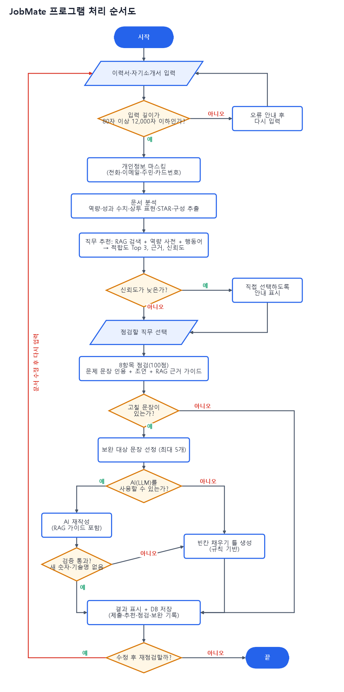
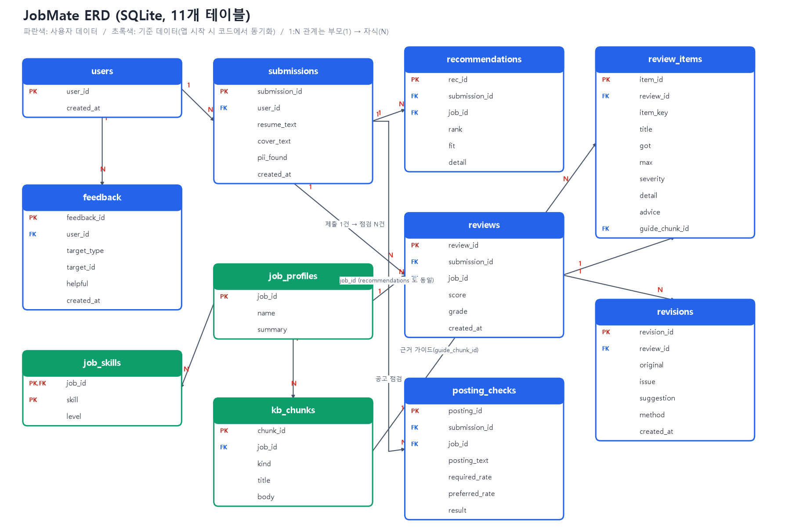
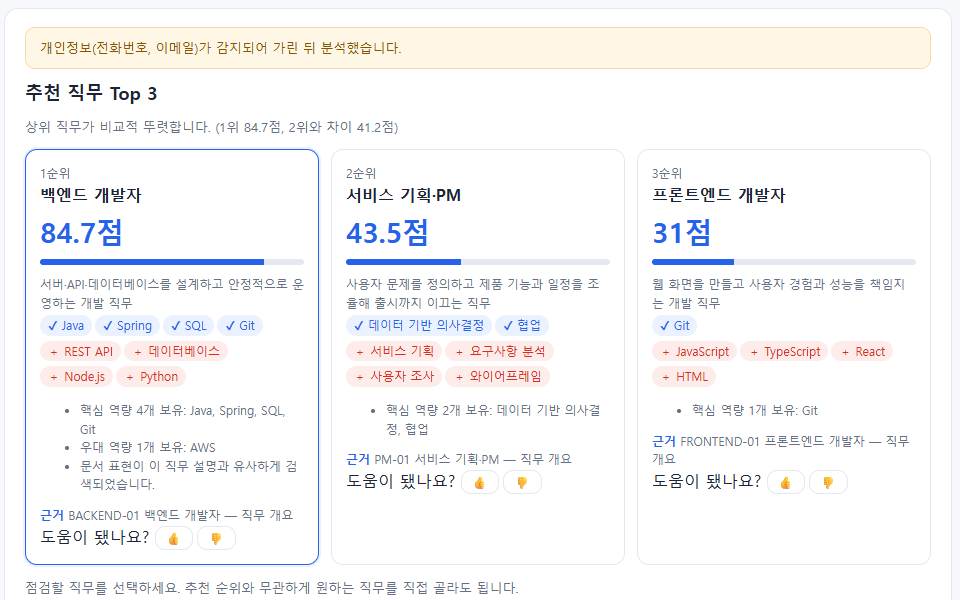
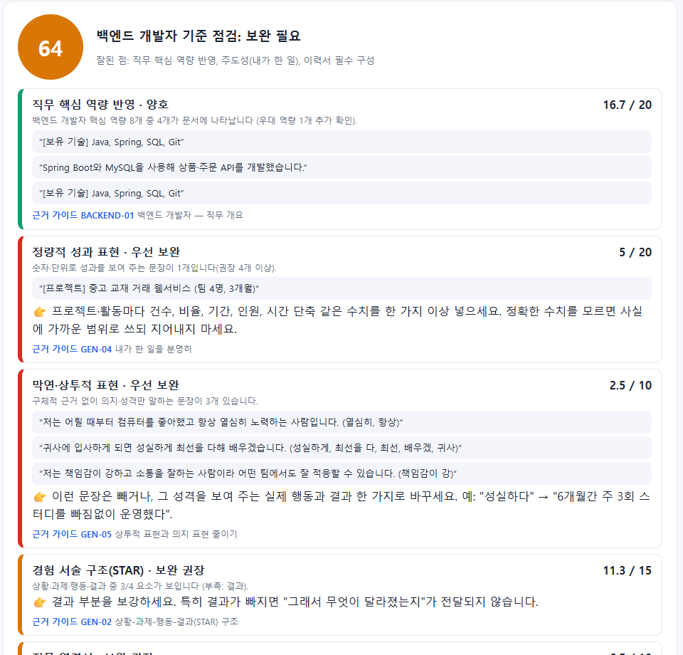
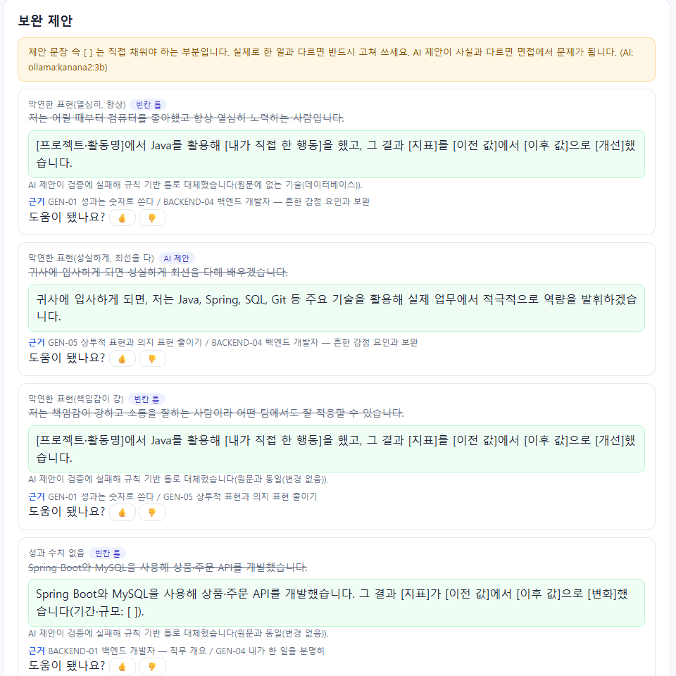

# JobMate 결과보고서 (초안)

인공지능 응용 시스템 개발 종합 프로젝트 · 작성일 2026-11-25(초안, 최종 12/24) · 작성자 반재영 (개인 프로젝트)

> 이 초안은 현재까지 실측한 결과만 담았습니다. `[예정]`은 12월에 채웁니다. 실제 사용자 평가는 미실시이며 모의 평가로 대체했습니다(4.6절).

## 1. 프로젝트 개요
| 항목 | 내용 |
|---|---|
| 프로젝트명 | JobMate — RAG 기반 직무 추천 및 이력서·자기소개서 검토·보완 시스템 |
| 목표 | 문서에서 어울리는 직무를 근거와 함께 추천, 직무 기준 8항목 점검, AI가 사실을 지어내지 않는 보완 제안 |
| 개발 기간 | 2026-11-25 ~ 12-30 |
| 개발 환경 | Node.js 24, SQLite, 외부 npm 패키지 없음 |

## 2. 수행 내용
| 단계 | 수행 | 산출물 |
|---|---|---|
| 기획 | 주제 확정, 범위·일정 | 기획서 |
| 설계 | 요구사항 분석·명세, 아키텍처, RAG·점수 설계, ERD | 분석서·명세서·데이터정의서·순서도 |
| 분석·구현 | 지식베이스(직무 13종, 청크 60개), 검색기, 추천·점검·보완, DB·API·화면 | 소스 약 1,500줄(주석 포함) |
| 테스트 | 자동 테스트 52개, 추천 정확도 평가, LLM 실호출 | 테스트 결과서 |
| 유지보수 | 모의 평가 결과 반영(완료), 지식 보강 `[예정]` | 개선 내역 |

## 3. 시스템 구성
핵심: 규칙 기반 문서 분석 + BM25(선택적 임베딩) 검색 + LLM 재작성 후 사후 검증. (아키텍처·RAG 파이프라인은 기획서 5장 참조)

**처리 순서도**

**데이터 구조(ERD, 11개 테이블)**

## 4. 결과
### 4.1 기능과 실행 화면
추천 Top 3(근거·신뢰도), 8항목 점검(원문 인용·조언·근거 가이드), 보완 제안(AI/빈칸 틀), 채용 공고 요건 대조(충족/부분/못 찾음, 학력·경력 조건 안내), 기록, 피드백, 지표 — 요구사항 FR-01~09, NFR-01~08 구현.

**직무 추천 화면**

**직무 맞춤 점검 화면**

**보완 제안 화면(AI 제안/빈칸 틀, 검증 실패 사유 표시)**

### 4.2 직무 추천 정확도
| 설정 | 쉬운 셋 Top-1 (26건) | 어려운 셋 Top-1 (10건) | 어려운 셋 Top-3 |
|---|---|---|---|
| 역량 사전만 | 100% | 30% | 40% |
| RAG 검색만 | 100% | 80% | 100% |
| 전체 결합(채택) | 100% | 80% | 100% |

RAG 결합으로 어려운 문서에서 30%→80%. 오답 2건(프론트→PM, QA→백엔드)은 정답이 2순위.

### 4.3 품질·성능
- 자동 테스트 52/52 통과(마스킹·추천·점검·날조 차단·IDOR·경로 이탈·입력 한도·429·재시작).
- 샘플 1건 로컬 측정: 추천 8.5ms, 점검 2.4ms, 규칙 보완 2.1ms.
- Ollama(kanana2:3b) 보완 실측: 5문장 중 AI 채택 1, 검증 실패로 규칙 대체 4.

### 4.4 공고 기반 점검
공고의 자격요건·우대사항을 서류와 한 줄씩 대조하는 규칙 기반 기능(AI 미사용). 기술명은 직무 사전, 문장은 글자 겹침으로 비교하며 근거 문장을 함께 제시합니다. 학력·경력 연차처럼 자동 판단이 위험한 조건은 "확인 필요/미충족 가능"으로만 안내합니다. 한계: 같은 뜻의 다른 표현은 못 찾을 수 있고, 실제 공고 다수로 정확도를 측정하지 못했습니다(`[예정]`).

### 4.5 모의 사용자 평가(예비)
가상 지원자 12명(정보 거의 없는 문서, 고졸 지원자 포함)의 문서를 실제 경로에 통과시켜 객관 지표를 측정했습니다(추천 1순위 일치 12/12, 점검 점수 평균 36.8→78, 보완 제안 40건 중 날조 0건, 공고 필수 충족도 63.8%→85.4%). 이 과정에서 결함 6건(날조 검증의 빈칸 오인, 공유 별칭 오판, 표현 인식 누락, 직무별 별칭 덮어쓰기, 규칙 보완의 어색한 표현, 대안 항목 판정)을 찾아 수정했으며, 지원자를 6명에서 12명으로 늘리자 새 결함이 드러났다는 점이 실제 사용자 평가의 필요성을 보여 줍니다. **작성자가 만든 문서이고 설문을 하지 않았으므로 실제 사용자 평가를 대신하지 못합니다.**

### 4.6 실제 사용자 평가 — 미실시, 모의 평가로 대체
| 항목 | 내용 |
|---|---|
| 상태 | **미실시** (실제 사용자 3~5명 평가는 진행하지 않음) |
| 사유 | 일정과 평가 인력 확보의 제약. 평가 대상(지인)을 모집해 개인정보 동의를 받고 진행하는 데 필요한 시간이 개발 일정 안에 확보되지 않았음 `[실제 사유에 맞게 수정]` |
| 대체 수단 | 4.5절의 **모의 사용자 평가**(가상 지원자 12명)로 객관 지표(추천 일치, 점검 점수 변화, 보완 제안 날조 여부, 공고 충족도, 처리 시간)를 측정하고 결함 6건을 수정 |
| 모의 평가로 확인하지 못한 것 | 유용성·신뢰성·사용성 같은 **주관 평가**. 가상 문서와 "수정 후" 문서를 작성자가 직접 만들었으므로 실제 사용자 문서에서의 정확도와 만족도를 보장하지 않음 |
| 평가 준비 상태 | 평가 계획·설문(사용자평가계획), 평가자 안내문, 설문 집계 도구(`tools/analyze_survey.mjs`)를 이미 갖춰 두어 **언제든 같은 지표로 실제 평가를 실시할 수 있음** |
| 향후 과제 | 실제 사용자 평가 실시 → 설문 집계 → 모의 평가 결과와 비교해 보고서 갱신 |

> 이 보고서의 정확도·품질 수치는 **작성자가 만든 가상 데이터 기준**이며, 실제 사용자 평가를 거치지 않았음을 명시합니다.

## 5. 문제와 해결
| 문제 | 원인 | 해결 |
|---|---|---|
| 재시작 시 FK 오류 | INSERT OR REPLACE | UPSERT + 회귀 테스트 |
| 빈약한 문서도 신뢰도 high | 검색 점수가 상대값 | 찾은 역량 수·행동어로 보정 |
| 보완 문장 잘림 | 정규식 부분 제거 | 막연한 문장은 빈칸 틀로 교체 |
| AI가 원문 그대로 반환 | 소형 모델 특성 | 원문 동일 검증 |
| 쉬운 셋 100% 의심 | 사전 제작자가 만든 문서 | 어려운 셋·ablation 추가 |

## 6. 한계
가상 평가 데이터와 같은 셋으로 고른 가중치(과대평가 가능), 직무 지식은 예시 기준, Claude·ChatGPT·임베딩 실측 미완, 로그인·파일 업로드·공고 연동 없음, 숫자·기술명 외 의미적 과장은 검증 불가, 이름·학교 같은 개인정보는 마스킹 못함.

## 7. 향후 계획
실제 사용자 평가 실시와 반영, 공고 점검 정확도를 실제 공고 다수로 측정, 직무 지식 확대, 로그인·HTTPS, Claude·ChatGPT·임베딩 실측, PDF/Word 업로드.

## 8. 자체 평가
| 목표 | 달성 | 근거 |
|---|---|---|
| 근거 있는 직무 추천 | 달성 | 근거 청크·보유/부족 역량 표시 |
| 문서 점검·보완 | 달성 | 8항목, 원문 인용 |
| 환각 방지 | 부분 달성 | 숫자·기술명은 차단, 의미적 과장은 못 막음 |
| 정확도 | 가상 데이터 기준 달성 | 실제 사용자 평가 미실시(4.6절), 향후 과제 |

## 9. 요구사항 충족 현황
| ID | 요구사항 | 결과 | 확인 근거 |
|---|---|---|---|
| FR-01 | 문서 입력·개인정보 마스킹 | 충족 | 마스킹·입력 검증 테스트 |
| FR-02 | 직무 추천(근거·신뢰도) | 충족 | 사전 문장 13종 1순위 테스트, 평가셋·모의 평가 |
| FR-03 | 8항목 직무 점검 | 충족 | 점검 항목·점수 격차 테스트 |
| FR-04 | 보완 제안(AI 검증·빈칸 틀) | 충족 | 날조 차단·LLM 경로 테스트, Ollama 실호출 |
| FR-05 | 근거 가이드 표시 | 충족 | 항목마다 근거 청크 존재 테스트 |
| FR-06 | 기록·점수 변화 | 충족 | API 흐름 테스트 |
| FR-07 | 피드백·운영 지표 | 충족 | API 흐름 테스트 |
| FR-08 | 직무 직접 선택·샘플 | 충족 | 화면 확인 |
| FR-09 | 채용 공고 기반 점검 | 충족(정확도 한계 있음) | 공고 테스트 9개, 모의 평가 |
| NFR-01 | LLM 없이 동작 | 충족 | LLM off 상태 전체 테스트 |
| NFR-02 | 성능 1초 이내 | 충족 | 실측 수 ms, 최악 입력 40ms |
| NFR-03·04 | 보안·개인정보 | 충족(로그인 없음은 한계) | IDOR·경로 이탈·한도·429·마스킹 테스트 |
| NFR-05 | 신뢰성(재시작·트랜잭션) | 충족 | 재시작 회귀 테스트 |
| NFR-06 | 설치성(npm 불필요) | 충족 | `npm start` 실행 |
| NFR-07 | 유지보수성(주석·테스트) | 충족 | 파일별 이유 주석, 자동 테스트 52개 |
| NFR-08 | 환각 방지 | 부분 충족 | 숫자·기술명 차단, 의미적 과장은 못 막음 |

## 10. 일정 대비 실적
| 단계 | 계획 | 실적 |
|---|---|---|
| 기획 | 11/25~12/04 | 기획서 작성 완료(제출 12/04) |
| 설계 | 11/25~11/28 | 요구사항 분석서·명세서, ERD, 순서도 완료 |
| 분석·구현 | 11/25~12/08 | 핵심 기능과 공고 점검까지 구현 완료 |
| 테스트 | 12/08~12/19 | 자동 테스트 52개, 평가셋·모의 평가(12명) 완료, **실제 사용자 평가 미실시** |
| 유지보수 | 12/15~12/24 | 모의 평가 결함 6건 수정 완료, 지식 보강은 예정 |
| 발표 | 12/30 | 발표자료·시연 시나리오 준비 완료 |

## 11. 개발 과정에서의 AI 도구 활용 (공개)
- 이 프로젝트의 코드와 문서는 AI 코딩 도구(Claude Code)의 도움을 받아 작성했습니다. 작성자는 요구와 방향을 정하고 결과를 검토했으며, 모든 소스 파일에 "무엇을 하는지, 왜 그렇게 했는지"를 설명하는 주석을 달아 동작과 이유를 이해하고 설명할 수 있도록 했습니다(면접 대비 코드 가이드 별도 작성).
- 프로그램 안에서는 문서 분석·점수 계산에 AI를 쓰지 않고(재현성·개인정보), 문장 재작성에만 LLM을 보조로 쓰며 결과를 검증합니다.
- AI가 만든 결과를 그대로 믿지 않기 위해 자동 테스트, 어려운 평가셋, 모의 평가로 검증했고, 그 과정에서 AI가 만든 코드의 결함도 여럿 발견해 수정했습니다(5장).

## 12. 배운 점
- **높은 점수를 먼저 의심하기:** 쉬운 평가셋에서 100%가 나오자 어려운 셋을 추가했고, 사전만으로는 30%라는 사실과 RAG의 기여(80%)를 수치로 확인했습니다.
- **LLM을 믿지 않고 검증하기:** 없는 숫자·기술명을 만들어 내는 위험 때문에 사후 검증을 만들었고, 그 검증 자체에도 오탐이 있어 모의 평가로 다시 고쳤습니다.
- **표본이 늘면 결함이 늘어난다:** 가상 지원자를 6명에서 12명으로 늘리자 새 결함이 나왔습니다. 그래서 실제 사용자 평가가 필요하지만 이번에는 하지 못했다는 점을 한계로 남깁니다.
- **자동 테스트의 가치:** 서버 재시작 오류처럼 직접 써 보기 전에는 몰랐던 결함을 테스트와 반복 실행으로 찾았습니다.
- `[본인의 소감과 느낀 점을 직접 한두 문장 추가하세요]`
