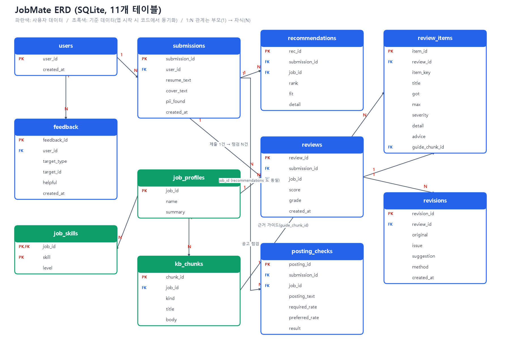
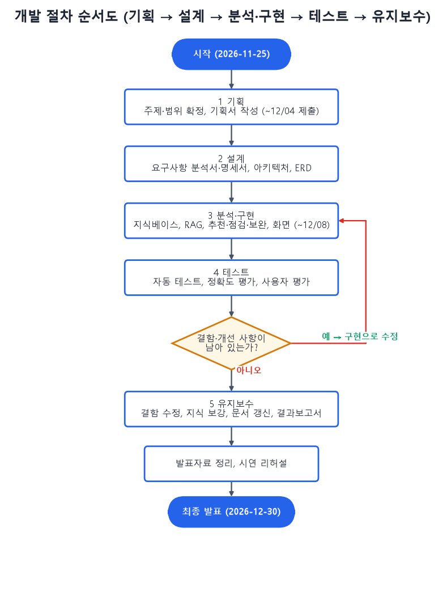
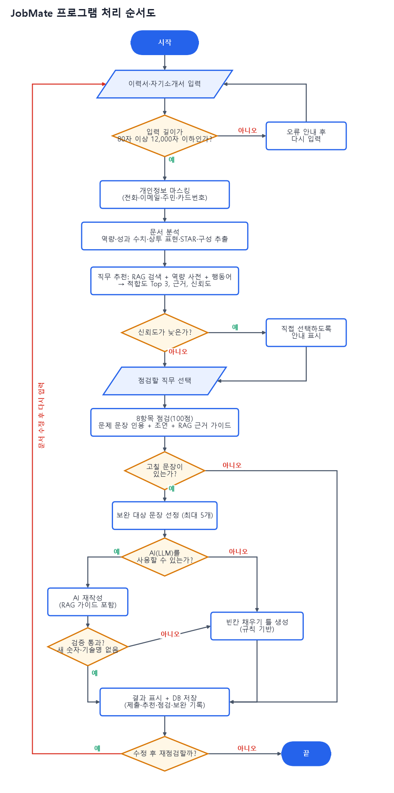

# JobMate 프로젝트 기획서

인공지능 응용 시스템 개발 종합 프로젝트 · 작성일 2026-11-25 · 작성자 반재영 (개인 프로젝트)

## 1. 프로젝트 개요

| 항목 | 내용 |
|---|---|
| 프로젝트명 | JobMate — RAG 기반 직무 추천 및 이력서·자기소개서 검토·보완 시스템 |
| 한 줄 요약 | 사용자가 쓴 이력서·자기소개서를 분석해 어울리는 직무를 근거와 함께 추천하고, 선택한 직무 기준으로 문서가 잘 쓰였는지 점검한 뒤 직무에 맞게 고쳐 쓰도록 돕는 취업 지원 도구 |
| 핵심 AI 기술 | RAG(검색 증강 생성: BM25 + 선택적 임베딩 하이브리드 검색), LLM 연동(Claude · ChatGPT · 로컬 Ollama 중 선택), 환각 방지 검증(숫자·기술명 대조), 규칙 기반 문서 분석 |
| 지식베이스 | 직무 13종 × 작성 가이드 4종 + 공통 원칙 8종 = 청크 60개(직접 작성) |
| 개발 환경 | Node.js 24+, SQLite(node:sqlite), HTML/CSS/JavaScript, 외부 npm 패키지 없음 |
| 산출물 | 실행 가능한 웹 프로그램, 기획서, 요구사항분석서·명세서, 개발일정표, 데이터정의서(ERD), 테스트 결과서, 발표자료(PPTX·PDF), 포트폴리오 |

## 2. 개발 배경과 목적

### 2.1 문제
취업 준비생은 이력서와 자기소개서를 쓰고도 두 가지를 확신하지 못합니다.

1. **"내가 어떤 직무에 어울리는가?"** — 전공·경험은 있는데 직무 이름과 연결하지 못합니다.
2. **"이 문서가 그 직무에 맞게 쓰였는가?"** — 경험을 나열했을 뿐 직무 역량·성과 수치·내가 한 일이 드러나지 않아도 스스로는 알기 어렵습니다.

일반 챗봇에게 첨삭을 맡기면 빠르지만, 없는 경험이나 수치를 그럴듯하게 지어내거나(환각) 근거 없는 기준으로 평가해 그대로 믿고 제출하기 어렵습니다. 면접에서 사실과 다른 내용이 드러나면 지원자에게 치명적입니다.

### 2.2 목표
1. 문서에서 **역량·성과 단서를 찾아** 어울리는 직무 Top 3를 **근거(보유 역량, 참고한 지식 항목)와 함께** 추천한다.
2. 사용자가 고른 직무 기준으로 **8개 항목(100점)** 으로 점검하고, 문제 문장을 **원문 그대로 인용**하며 고치는 방법을 안내한다.
3. 문장 보완을 제안하되 **원문에 없는 숫자·기술은 만들지 않는다**(검증 실패 시 빈칸 채우기 틀로 대체).
4. 모든 조언에 **근거 가이드(RAG 출처)** 를 붙여 왜 그런 조언인지 확인할 수 있게 한다.
5. 점검 기록을 남겨 **수정 전후 점수 변화**를 볼 수 있게 한다.
6. 개인정보(전화·이메일·주민번호)는 **저장·외부 전송 전에 마스킹**한다.

## 3. 사용자와 시나리오

| 사용자 | 하고 싶은 일 | 시스템 응답 |
|---|---|---|
| 취업 준비생(주 사용자) | 내 문서에 맞는 직무를 알고 싶다 | 직무 Top 3, 적합도, 보유·부족 역량, 근거 |
| 취업 준비생 | 목표 직무에 맞게 문서를 고치고 싶다 | 8개 항목 점검, 문제 문장 인용, 보완 문장 |
| 취업 준비생 | 고친 뒤 나아졌는지 확인하고 싶다 | 재점검, 기록의 점수 변화 |
| 운영자(작성자) | 서비스 품질을 보고 싶다 | 누적 제출 수, 평균 점수, 도움이 됨 비율 |

**대표 시나리오**: 문서 입력 → (개인정보 자동 마스킹) → 직무 추천 → 직무 선택 → 점검 → 보완 제안 확인 → 문서 수정 → 재점검.

## 4. 주요 기능

| ID | 기능 | 설명 |
|---|---|---|
| FR-01 | 문서 입력·마스킹 | 이력서·자소서 입력(하나만 가능), 개인정보 가림 |
| FR-02 | 직무 추천 | 역량 사전 + RAG 검색 + 행동어 점수로 Top 3, 신뢰도 안내 |
| FR-03 | 직무 맞춤 점검 | 핵심 역량·정량 성과·STAR·직무 연결·주도성·상투 표현·구성·분량 |
| FR-04 | 보완 제안 | AI 재작성(검증 통과 시) 또는 빈칸 채우기 틀 |
| FR-05 | 근거 표시 | 추천·점검·보완마다 참고한 지식 청크 ID·제목 |
| FR-06 | 기록 | 제출·추천·점검 점수 이력 |
| FR-07 | 평가·지표 | 👍/👎 피드백, 운영 지표 |
| FR-08 | 직무 직접 선택·샘플 | 추천과 무관하게 직무 선택, 시연용 샘플 |
| FR-09 | 채용 공고 기반 점검 | 공고의 자격요건·우대사항을 서류와 한 줄씩 대조(충족/부분/못 찾음+근거 문장), 학력·경력 조건 안내, 서류에 없는 요구 기술, 공고와 가까운 직무 |

## 5. 시스템 설계 개요

### 5.1 아키텍처
```
[브라우저 UI] ──HTTP/JSON──> [http.mjs: 검증·제한·보안헤더]
                                   │
                           [app.mjs: 업무 흐름]
        ┌──────────────┬───────────┼───────────────┬──────────────┐
  [text/profile]  [rag.mjs]  [recommend/review]  [revise.mjs]  [db.mjs]
  마스킹·특징추출   BM25(+임베딩)   점수·점검         재작성+검증     SQLite
                      │                                 │
                 [kb.mjs ← jobs.mjs]               [llm.mjs: Claude/ChatGPT/Ollama]
```

### 5.2 RAG 파이프라인
1. **지식베이스 구축**: 직무별 가이드(개요·이력서·자소서·감점 요인)를 청크로 분할 → 색인(BM25 토큰·선택적 임베딩).
2. **검색(Retrieval)**: 사용자 문서(또는 문제 문장)를 질의로 직무 청크를 검색. 한국어 조사 변화에 견디도록 어절 + 글자 바이그램 토큰 사용.
3. **보강(Augmented)**: 검색된 가이드를 LLM 프롬프트의 "작성 가이드"로 삽입하고 화면에 근거로 표시.
4. **생성(Generation)**: LLM이 원문 사실만으로 문장을 재작성. 결과는 **사후 검증**(새 숫자·새 기술명 금지, 원문 동일·거절 문구 차단)을 통과해야 채택, 실패 시 규칙 기반 틀.

### 5.3 직무 추천 점수
`적합도 = 0.40×역량 일치도 + 0.50×검색 유사도 + 0.10×행동어`. 여러 직무에 흔한 기술(Git, SQL 등)은 특이도 가중으로 영향 축소. 1순위 점수가 낮거나 단서(찾은 역량 수)가 부족하면 신뢰도를 낮게 안내.

### 5.4 데이터 설계
SQLite 11개 테이블: 기준 데이터(job_profiles, job_skills, kb_chunks) + 사용자 데이터(users, submissions, recommendations, reviews, review_items, revisions, posting_checks, feedback). 상세는 데이터정의서·ERD 참조.



### 5.5 API
`POST /api/analyze · /api/review · /api/revise · /api/posting · /api/feedback`, `GET /api/status · /api/jobs · /api/history · /api/stats · /api/kb/search · /api/sample`

### 5.6 개발 절차 순서도
개발은 아래 순서로 진행하며, 테스트에서 결함·개선 사항이 나오면 구현 단계로 되돌아가 고친 뒤 다시 테스트합니다.



### 5.7 프로그램 처리 순서도
사용자가 문서를 입력해 직무 추천을 받고, 점검·보완을 거쳐 저장하기까지의 처리 흐름입니다. 입력 오류, 신뢰도 낮음, AI 사용 불가, AI 검증 실패 같은 분기와 예외를 포함합니다.



## 6. 활용 기술과 선택 이유

| 기술 | 선택 이유 |
|---|---|
| Node.js 24 + node:sqlite | 설치 없이 `node server.mjs`로 실행, npm 패키지 없음(설치 오류·취약점·라이선스 부담 감소) |
| BM25 | 계산이 빠르고 점수를 설명할 수 있으며 외부 서비스 불필요 |
| 임베딩(선택) | 동의어·표현 차이 보완. Ollama가 있을 때만 사용하고 없으면 BM25로 계속 동작 |
| 규칙 기반 문서 분석 | 같은 입력 → 같은 결과(재현성), 환각 없음, 비용·개인정보 부담 없음 |
| LLM(Claude/ChatGPT/Ollama) | 문장 재작성처럼 규칙이 어려운 부분만 보조. 어댑터로 교체 가능 |

## 7. 평가 계획

| 대상 | 방법 | 목표 |
|---|---|---|
| 직무 추천 | 가상 문서 평가셋(쉬운 26건 + 기술명을 풀어 쓴 어려운 10건)의 Top-1·Top-3 | 쉬운 셋 Top-1 90%↑, 어려운 셋 Top-3 90%↑ (현재 100% / 80% / 100%) |
| 점검 | 좋은 문서 vs 나쁜 문서 점수 격차, 항목별 단위 테스트 | 격차 20점↑ |
| 보완 | 날조(새 숫자·새 기술) 차단율 | 검증 통과 제안 중 날조 0건 |
| 안정·보안 | 자동 테스트(IDOR·경로이탈·입력한도·재시작) | 전부 통과(현재 41개) |
| 사용자 평가 | 👍 비율, 지인 3~5명 시연 | 결과보고서에 정직하게 기록 |

> 정직한 한계: 평가 문서는 작성자가 직접 쓴 가상 데이터이고 가중치도 같은 셋으로 골랐으므로 실제 사용자 정확도는 낮을 수 있습니다. 결과보고서에 별도 사용자 평가를 추가할 예정입니다.

## 8. 개발 단계와 일정

개발은 **기획 → 설계 → 분석(구현) → 테스트 → 유지보수** 순서로 진행합니다. (상세는 개발일정표)

| 단계 | 기간 | 산출물 | 상태 |
|---|---|---|---|
| 기획 | 11/25~12/04 | 기획서 | 작성 완료, 12/04 제출 |
| 설계 | 11/25~12/05 | 요구사항 분석서·명세서, ERD, 아키텍처 | 초안 완료 |
| 분석·구현 | 11/25~12/12 | 소스 코드(주석 포함), 지식베이스 | 핵심 기능 구현 완료 |
| 테스트 | 12/08~12/19 | 테스트 결과서, 평가 | 자동 테스트 41개 통과, 사용자 평가 예정 |
| 유지보수 | 12/15~12/24 | 개선·문서 갱신 | 예정 |
| 발표 준비·발표 | 12/22~12/30 | 발표자료, 시연 | 발표자료 초안 완료 |

## 9. 위험과 대응

| 위험 | 대응 |
|---|---|
| LLM이 없는 경험·수치를 지어냄 | 프롬프트 제약 + 사후 검증 + 빈칸 틀 + 화면 경고 |
| 이력서의 개인정보 유출 | 저장·전송 전 마스킹, 로컬 바인딩(127.0.0.1), 익명 ID, 본인 데이터만 조회 |
| 직무 사전이 실제 공고와 다름 | 예시 기준임을 명시, 지식베이스를 파일로 분리해 갱신 가능, 지원 직전 공고 우선 안내 |
| 평가셋이 작고 편향 | 한계를 문서에 명시, 사용자 평가 추가 |
| 일정 지연 | 핵심(추천·점검·보완)을 먼저 완성, 임베딩·카카오 연동 등은 선택 기능 |

## 10. 기대 효과와 확장

- 직무 방향이 불분명한 지원자에게 **근거 있는 출발점** 제공, 문서의 약점을 **구체적 문장 단위**로 확인.
- 확장: 직무 지식 확대, PDF/Word 이력서 업로드, 면접 질문 생성.
