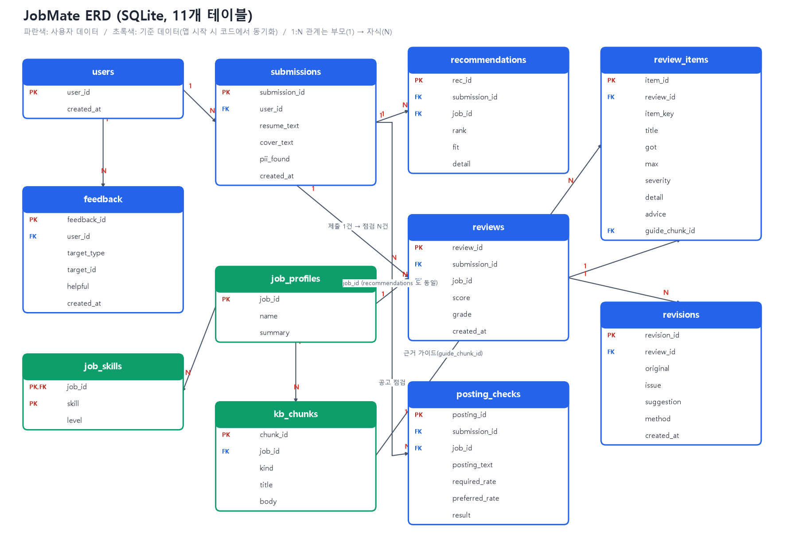

# JobMate 데이터정의서

작성일 2026-11-25 · 작성자 반재영 · DBMS: SQLite(node:sqlite) · 구현: `src/db.mjs`

## 1. ERD

- 파란색: 사용자 데이터 / 초록색: 기준 데이터(앱 시작 시 `jobs.mjs`와 동기화, UPSERT).
- 관계: users 1:N submissions · feedback / submissions 1:N recommendations · reviews · posting_checks / reviews 1:N review_items · revisions / job_profiles 1:N job_skills · kb_chunks · recommendations · reviews / kb_chunks 1:N review_items(근거 가이드).
- 외래키는 `PRAGMA foreign_keys = ON`으로 강제.

## 2. 테이블 목록

| 테이블 | 한글명 | 구분 | 설명 |
|---|---|---|---|
| job_profiles | 직무 | 기준 | 직무 13종 |
| job_skills | 직무 역량 | 기준 | 직무별 핵심(core)·우대(nice) 역량 |
| kb_chunks | 지식 청크 | 기준 | RAG 검색 대상(60개) |
| users | 사용자 | 사용자 | 익명 ID만 저장 |
| submissions | 제출 문서 | 사용자 | 마스킹된 이력서·자소서 |
| recommendations | 추천 결과 | 사용자 | 제출별 Top 3 |
| reviews | 점검 결과 | 사용자 | 제출·직무별 점수 |
| review_items | 점검 항목 | 사용자 | 8개 항목 상세 |
| revisions | 보완 제안 | 사용자 | 원문→제안 문장 |
| posting_checks | 공고 점검 | 사용자 | 채용 공고 요건 대조 결과(공고 원문은 마스킹 후 저장) |
| feedback | 피드백 | 사용자 | 👍/👎 |

## 3. 테이블 정의

### 3.1 job_profiles
| 컬럼 | 타입 | 제약 | 설명 |
|---|---|---|---|
| job_id | TEXT | PK | 직무 코드(backend 등) |
| name | TEXT | NN | 직무명 |
| summary | TEXT | NN | 한 줄 설명 |

### 3.2 job_skills
| 컬럼 | 타입 | 제약 | 설명 |
|---|---|---|---|
| job_id | TEXT | PK, FK→job_profiles | 직무 |
| skill | TEXT | PK | 역량명 |
| level | TEXT | NN, CHECK core/nice | 핵심/우대 |

### 3.3 kb_chunks
| 컬럼 | 타입 | 제약 | 설명 |
|---|---|---|---|
| chunk_id | TEXT | PK | 예: BACKEND-02, GEN-01 |
| job_id | TEXT | FK→job_profiles, NULL 허용 | NULL이면 공통 가이드 |
| kind | TEXT | NN | overview/resume/cover/pitfall/general |
| title | TEXT | NN | 제목 |
| body | TEXT | NN | 본문 |

### 3.4 users
| 컬럼 | 타입 | 제약 | 설명 |
|---|---|---|---|
| user_id | TEXT | PK | 브라우저가 만든 익명 난수 ID |
| created_at | TEXT | NN | ISO 시각 |

### 3.5 submissions
| 컬럼 | 타입 | 제약 | 설명 |
|---|---|---|---|
| submission_id | INTEGER | PK AI | 제출 번호 |
| user_id | TEXT | NN, FK→users | 소유자 |
| resume_text | TEXT | NN, 기본 '' | 마스킹된 이력서 |
| cover_text | TEXT | NN, 기본 '' | 마스킹된 자소서 |
| pii_found | TEXT | NN | 감지된 개인정보 종류(JSON) |
| created_at | TEXT | NN | 제출 시각 |

### 3.6 recommendations
| 컬럼 | 타입 | 제약 | 설명 |
|---|---|---|---|
| rec_id | INTEGER | PK AI | |
| submission_id | INTEGER | NN, FK→submissions | |
| job_id | TEXT | NN, FK→job_profiles | 추천 직무 |
| rank | INTEGER | NN | 1~3 |
| fit | REAL | NN | 적합도 0~100 |
| detail | TEXT | NN | 점수 구성·보유/부족 역량(JSON) |

### 3.7 reviews
| 컬럼 | 타입 | 제약 | 설명 |
|---|---|---|---|
| review_id | INTEGER | PK AI | |
| submission_id | INTEGER | NN, FK | |
| job_id | TEXT | NN, FK | 점검 기준 직무 |
| score | INTEGER | NN | 0~100 |
| grade | TEXT | NN | 양호/보완 필요/대폭 보완 필요 |
| created_at | TEXT | NN | |

### 3.8 review_items
| 컬럼 | 타입 | 제약 | 설명 |
|---|---|---|---|
| item_id | INTEGER | PK AI | |
| review_id | INTEGER | NN, FK→reviews | |
| item_key | TEXT | NN | skills/quant/weak/star/link/initiative/structure/length |
| title | TEXT | NN | 항목명 |
| got / max | REAL | NN | 득점/배점 |
| severity | TEXT | NN | ok/mid/high |
| detail | TEXT | NN | 현황 설명 |
| advice | TEXT | NN | 조언 |
| guide_chunk_id | TEXT | FK→kb_chunks | 근거 가이드 |

### 3.9 revisions
| 컬럼 | 타입 | 제약 | 설명 |
|---|---|---|---|
| revision_id | INTEGER | PK AI | |
| review_id | INTEGER | NN, FK→reviews | |
| original | TEXT | NN | 원문 문장 |
| issue | TEXT | NN | 문제점 |
| suggestion | TEXT | NN | 제안 문장 |
| method | TEXT | NN, CHECK llm/rule | 생성 방식 |
| created_at | TEXT | NN | |

### 3.10 posting_checks
| 컬럼 | 타입 | 제약 | 설명 |
|---|---|---|---|
| posting_id | INTEGER | PK AI | |
| submission_id | INTEGER | NN, FK→submissions | 어느 제출 서류와 대조했는지 |
| job_id | TEXT | FK→job_profiles | 공고와 가장 가까운 직무 |
| posting_text | TEXT | NN | 공고 원문(연락처 마스킹 후) |
| required_rate | INTEGER | | 필수 요건 충족도(%), 해당 없으면 NULL |
| preferred_rate | INTEGER | | 우대 요건 충족도(%) |
| result | TEXT | NN | 항목별 상세 결과(JSON) |
| created_at | TEXT | NN | |

### 3.11 feedback
| 컬럼 | 타입 | 제약 | 설명 |
|---|---|---|---|
| feedback_id | INTEGER | PK AI | |
| user_id | TEXT | NN, FK→users | |
| target_type | TEXT | NN, CHECK | recommendation/review/revision |
| target_id | INTEGER | NN | 대상 PK |
| helpful | INTEGER | NN, CHECK 0/1 | |
| created_at | TEXT | NN | |

## 4. 인덱스
`idx_sub_user(submissions.user_id)`, `idx_rec_sub`, `idx_rev_sub`, `idx_item_rev`, `idx_post_sub` — 사용자·제출 기준 조회가 잦아 추가.

## 5. 데이터 관리 정책
| 항목 | 정책 |
|---|---|
| 개인정보 | 전화·이메일·주민·카드번호는 저장 전 치환. 실명·연락처 수집 안 함 |
| 접근 통제 | 모든 조회에 user_id 조건(타인 데이터 열람 불가) |
| 삭제 | 화면 「내 기록 모두 삭제」 또는 `POST /api/forget`(confirm:true)이 users 행을 지우면 ON DELETE CASCADE로 제출·추천·점검·항목·보완·공고 점검·피드백이 함께 삭제됨(복구 불가). 기준 데이터는 영향 없음 |
| 기준 데이터 갱신 | 서버 시작 시 UPSERT(기존 기록 보존) |
| 백업 | `data/jobmate.db` 파일 복사(WAL 모드이므로 서버 종료 후 권장) |
| 데이터 사전 | 직무 지식 원본: `knowledge/jobs.mjs` |
