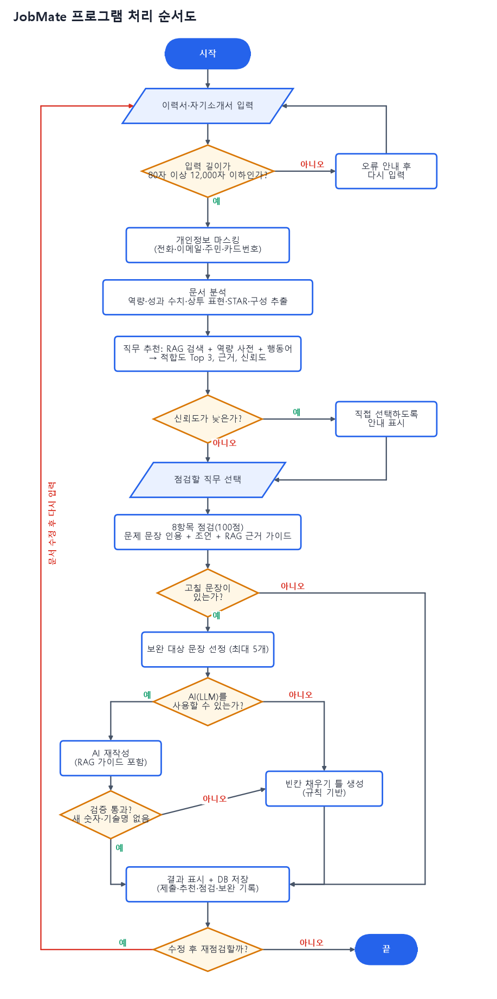

# JobMate 요구사항 분석서

작성일 2026-11-25 · 작성자 반재영 · 버전 1.0

## 목차

1. 개요
2. 시스템 범위와 이해관계자
3. 현황 분석과 문제 정의
4. 사용자 요구 분석
5. 기능 요구사항 분석
6. 비기능 요구사항 분석
7. 제약 사항과 가정
8. 유스케이스
9. 요구사항 우선순위
10. 추적성(요구사항 → 설계 → 구현 → 테스트)
11. 위험 분석

## 1. 개요

### 1.1 목적
이 문서는 JobMate가 **무엇을 해야 하는지**(요구사항)를 분석해 정리합니다. 설계·구현·테스트가 같은 기준으로 진행되도록 하고, 기획서의 목표를 검증 가능한 문장으로 바꾸는 것이 목적입니다.

### 1.2 시스템 개요
JobMate는 사용자가 작성한 이력서·자기소개서를 RAG 기반으로 분석해 ① 어울리는 직무를 추천하고 ② 선택한 직무 기준으로 문서를 점검하며 ③ 직무에 맞게 고쳐 쓰도록 보완 문장을 제안하는 웹 프로그램입니다.

### 1.3 용어
| 용어 | 뜻 |
|---|---|
| RAG | 검색 증강 생성. 관련 자료를 먼저 검색해 근거로 삼아 답을 만드는 방식 |
| 청크 | 검색 단위로 잘게 나눈 지식 조각(예: BACKEND-02) |
| BM25 | 단어 빈도·희소성 기반 문서 검색 점수 |
| STAR | 상황·과제·행동·결과로 경험을 서술하는 구조 |
| 환각 | AI가 근거 없는 내용을 사실처럼 만들어 내는 현상 |
| 적합도 | 문서와 직무의 유사 정도(0~100) |

## 2. 시스템 범위와 이해관계자

| 구분 | 내용 |
|---|---|
| 범위 안 | 텍스트 입력 문서 분석, 직무 13종 추천·점검, 문장 보완, 기록, 운영 지표 |
| 범위 밖(이번 버전) | PDF/Word 업로드, 채용 공고 연동, 로그인·회원, 면접 질문 생성, 외부 공개 배포 |
| 이해관계자 | 취업 준비생(사용자), 작성자·운영자(반재영), 평가자(교수자) |

## 3. 현황 분석과 문제 정의

| 현재 방식 | 문제 |
|---|---|
| 혼자 쓰고 혼자 판단 | 직무 적합성·문서 품질을 객관적으로 알기 어려움 |
| 지인·학원 첨삭 | 시간·비용 부담, 기준이 사람마다 다름 |
| 일반 챗봇 첨삭 | 근거 없는 평가, 없는 경험·수치를 만들어 낼 위험(환각) |

→ **근거(출처)를 보여 주고, 사실을 지어내지 않으며, 같은 입력엔 같은 점검 결과**를 주는 도구가 필요합니다.

## 4. 사용자 요구 분석
| ID | 사용자 요구 | 도출 근거 |
|---|---|---|
| UR-1 | 내 경험으로 어떤 직무를 노릴 수 있는지 알고 싶다 | 직무 방향 불확실 |
| UR-2 | 왜 그 직무인지 근거를 보고 싶다 | 블랙박스 추천 불신 |
| UR-3 | 문서의 구체적 문제 문장을 짚어 주면 좋겠다 | 막연한 총평은 수정 불가 |
| UR-4 | 고친 문장을 예시로 받고 싶다 | 어떻게 쓸지 모름 |
| UR-5 | AI가 없는 경력을 만들어 넣지 않았으면 한다 | 면접·사실 확인 위험 |
| UR-6 | 내 연락처가 유출되지 않았으면 한다 | 이력서는 민감 문서 |
| UR-7 | 수정 후 나아졌는지 확인하고 싶다 | 반복 개선 |

## 5. 기능 요구사항 분석
세부 명세는 「요구사항 명세서」에 있으며, 여기서는 분석 결과를 요약합니다.

| ID | 요구사항 | 근거 UR | 핵심 분석 |
|---|---|---|---|
| FR-01 | 이력서·자소서 입력과 개인정보 마스킹 | UR-6 | 저장·LLM 전송 이전에 마스킹해야 유출 위험 최소화 |
| FR-02 | 직무 Top 3 추천과 근거·신뢰도 | UR-1,2 | 단일 신호는 한계 → 역량 사전 + 검색 + 행동어 결합 |
| FR-03 | 선택 직무 기준 8항목 점검 | UR-3 | 점수와 함께 원문 인용·조언·출처 필요 |
| FR-04 | 보완 문장 제안 | UR-4,5 | 재작성은 LLM이 유리하나 환각 → 사후 검증 필수 |
| FR-05 | 근거 가이드 표시 | UR-2 | RAG 청크 ID·제목 노출 |
| FR-06 | 기록·점수 변화 | UR-7 | 제출별 점검 이력 저장 |
| FR-07 | 피드백·운영 지표 | 운영 | 품질 개선 근거 |
| FR-08 | 직무 직접 선택·샘플 | UR-1 | 추천이 틀려도 사용자가 선택 가능 |

## 6. 비기능 요구사항 분석
| ID | 분류 | 요구 | 분석 |
|---|---|---|---|
| NFR-01 | 가용성 | LLM·임베딩 없이도 전체 기능 동작 | 키·서버 부재가 흔함 → 규칙 경로 필수 |
| NFR-02 | 성능 | 추천·점검 1초 이내(규칙 경로) | 실측 수 ms~수십 ms |
| NFR-03 | 보안 | 타 사용자 데이터 접근 불가, 입력 한도, 호출 제한, 보안 헤더, 경로 이탈 차단 | 웹 기본 취약점 대응 |
| NFR-04 | 개인정보 | 마스킹 저장, 익명 ID, 로컬 바인딩 | 최소 수집 |
| NFR-05 | 신뢰성 | 재시작·오류 시 데이터 보존, 반쪽 저장 방지(트랜잭션) | DB 무결성 |
| NFR-06 | 설치성 | npm 설치 없이 실행 | 평가·시연 환경 단순화 |
| NFR-07 | 유지보수성 | 모든 코드에 이유 설명 주석, 자동 테스트, 지식베이스 분리 | 본인이 면접에서 설명해야 함 |
| NFR-08 | 정확성(환각 방지) | AI 제안의 새 숫자·새 기술명 차단 | 사실 왜곡 방지 |

## 7. 제약 사항과 가정
- 개인 프로젝트, 마감: 기획서 12/04, 발표 12/30.
- 직무 지식은 작성자가 정리한 **예시 기준**이며 실제 공고와 다를 수 있음(가정: 사용자는 지원 직전 공고를 별도 확인).
- 평가 데이터는 가상 문서(실제 사용자 데이터 없음).
- 외부 LLM 키는 보유하지 않을 수 있음(로컬 Ollama 또는 규칙 경로 사용).

## 8. 유스케이스

| UC | 이름 | 주 흐름 | 예외 |
|---|---|---|---|
| UC-1 | 직무 추천 받기 | 문서 입력 → 마스킹 → 분석 → Top 3 표시 | 입력 80자 미만 400, 너무 김 413, 단서 부족 시 신뢰도 low 안내 |
| UC-2 | 직무 점검 | 직무 선택 → 8항목 점수·문장 인용·조언·근거 | 다른 사용자 제출 접근 404 |
| UC-3 | 보완 제안 | 대상 문장 선정 → 재작성(AI/규칙) → 검증 → 표시 | AI 실패·검증 실패 → 규칙 틀 |
| UC-4 | 기록 확인 | 내 기록 목록, 점수 변화 | 기록 없음 |
| UC-5 | 피드백 | 👍/👎 저장 | 잘못된 유형 400 |

### 8.1 처리 순서도

## 9. 요구사항 우선순위 (MoSCoW)
- **Must**: FR-01~05, NFR-01, 03, 04, 08
- **Should**: FR-06, FR-08, NFR-02, 05, 07
- **Could**: FR-07 지표, 임베딩 하이브리드 검색
- **Won't(이번 버전)**: 파일 업로드, 공고 연동, 로그인

## 10. 추적성
| 요구 | 설계·구현 | 테스트 |
|---|---|---|
| FR-01 | text.mjs maskPII, app.mjs prepare | 마스킹 테스트, DB 마스킹 저장 테스트 |
| FR-02 | recommend.mjs, rag.mjs | 추천 3종 테스트, tools/eval.mjs |
| FR-03 | review.mjs | 점검 항목·격차 테스트 |
| FR-04 | revise.mjs | 규칙 보완·guard·LLM 경로 테스트 |
| NFR-03 | http.mjs, db.mjs getSubmission | IDOR·경로이탈·한도·429 테스트 |
| NFR-05 | db.mjs 트랜잭션·UPSERT | 재시작 테스트 |

## 11. 위험 분석
| 위험 | 영향 | 확률 | 대응 |
|---|---|---|---|
| 환각 | 높음 | 중 | 검증·빈칸 틀 |
| 개인정보 | 높음 | 낮음 | 마스킹·로컬 |
| 사전 부정확 | 중 | 중 | 예시 기준 명시·갱신 구조 |
| 일정 | 중 | 중 | 우선순위 |
