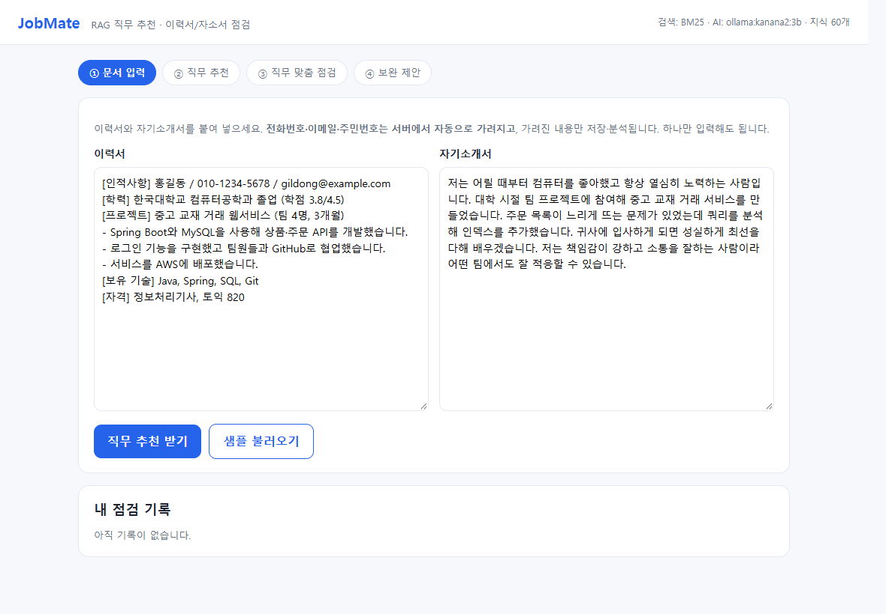
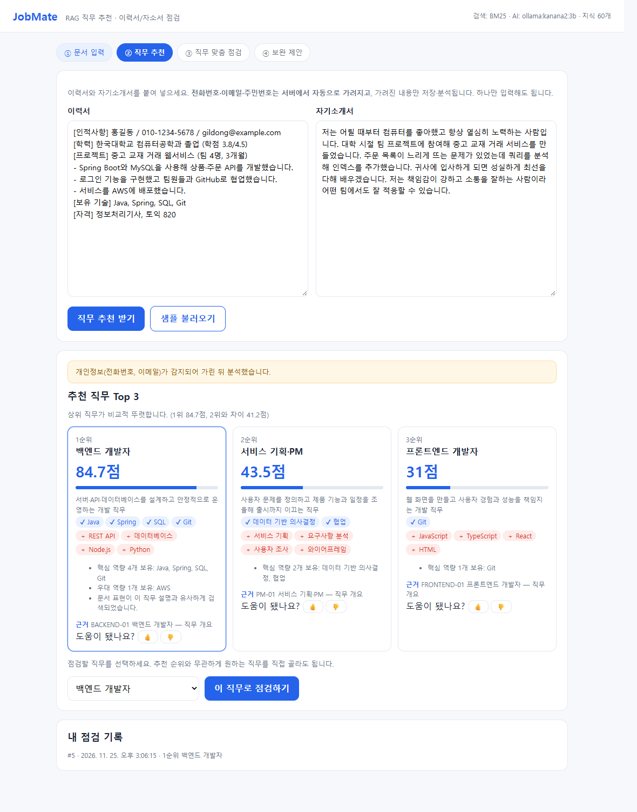
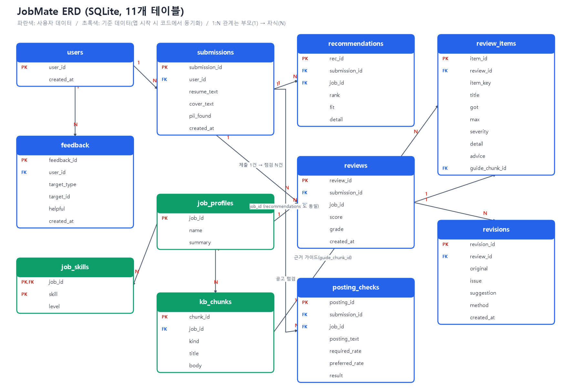

# 포트폴리오 — JobMate

반재영 · 인공지능 응용 시스템 개발 종합 프로젝트(개인) · 2026.11 ~ 12

## 한 줄 소개
이력서·자기소개서를 RAG로 분석해 **어울리는 직무를 근거와 함께 추천**하고, 선택 직무 기준으로 **점검·보완**하되 **AI가 없는 경력·수치를 지어내지 못하도록 검증**하는 웹 서비스.

## 프로젝트 정보
| 항목 | 내용 |
|---|---|
| 기간·인원 | 2026.11.25 ~ 12.30 · 1인(기획·설계·구현·테스트·문서 전부) |
| 기술 | Node.js 24, SQLite, JavaScript(프론트·백엔드), RAG(BM25 + 선택적 임베딩), LLM 어댑터(Claude·ChatGPT·Ollama) |
| 규모 | 소스 약 1,300줄(주석 포함), 직무 13종·지식 청크 60개, 테이블 11개, 자동 테스트 43개 |
| 실행 | `npm start` 한 줄, 외부 패키지 없음 |

## 문제와 해결
| 문제 | 해결 |
|---|---|
| 내 문서가 어떤 직무에 맞는지 모름 | 역량 사전·RAG 검색·행동어 3신호로 Top 3와 이유 제시 |
| 점검이 총평뿐이라 고칠 곳을 모름 | 8항목 점수 + 문제 원문 인용 + 조언 + 근거 가이드 |
| AI 첨삭이 없는 경험을 지어냄 | 숫자·기술명 사후 검증, 실패 시 빈칸 채우기 틀 |
| 이력서의 개인정보 | 저장·전송 전 마스킹, 로컬 바인딩, 본인 데이터만 조회 |

## 핵심 성과
- 직무 추천: 쉬운 평가셋 Top-1 100%, 기술명을 풀어 쓴 어려운 셋 Top-1 80%/Top-3 100%. 사전만 쓰면 30%였고 **RAG 결합으로 80%** 달성(가상 데이터 기준, 한계 명시).
- 응답 속도: 추천 8.5ms·점검 2.4ms(로컬 측정). LLM 없이도 전 기능 동작.
- 테스트로 **서버 재시작 시 DB 외래키 오류** 등 6건의 결함을 발견·수정하고 회귀 테스트로 고정.

## 화면

## 아키텍처·데이터

## 내가 한 기술적 선택과 이유
1. **BM25 기본 + 임베딩 선택**: 설명 가능성·무의존성, 서버가 있으면 의미 검색으로 보강.
2. **규칙 기반 분석 + LLM 보조**: 재현성·비용·개인정보·환각 때문에 LLM은 재작성에만 제한.
3. **사후 검증(guard)**: LLM을 신뢰하지 않고 결과를 원문과 대조.
4. **UPSERT·트랜잭션·FK**: 재시작과 부분 실패에도 데이터 무결성 유지.
5. **의존성 주입(fetchFn)**: 외부 API 없이 LLM 경로를 테스트.

## 배운 점과 한계
- 처음 100%가 나온 평가를 의심해 어려운 셋을 추가하면서 RAG의 실제 기여를 수치로 확인했습니다.
- 한계: 가상 평가 데이터, 일반화된 직무 지식, 로그인·업로드·공고 연동 없음, Claude·ChatGPT 실측 미완 → 사용자 평가와 공고 기반 점검으로 개선 예정.

## 산출물
기획서 · 요구사항 분석서·명세서 · 개발일정표 · 데이터정의서(ERD) · 테스트 결과서 · 면접 대비 코드 가이드 · 발표자료(PPTX/PDF) · 소스 코드(주석 포함)
